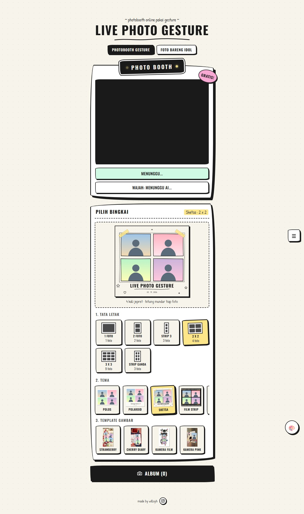
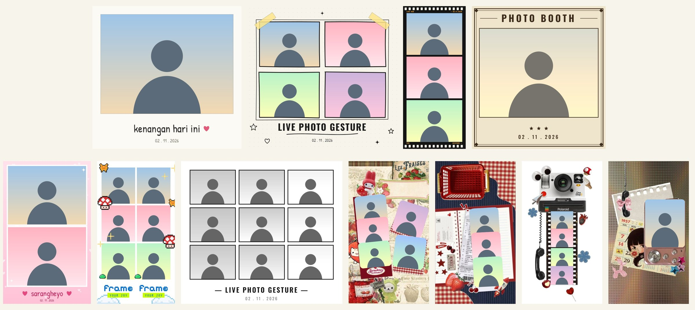
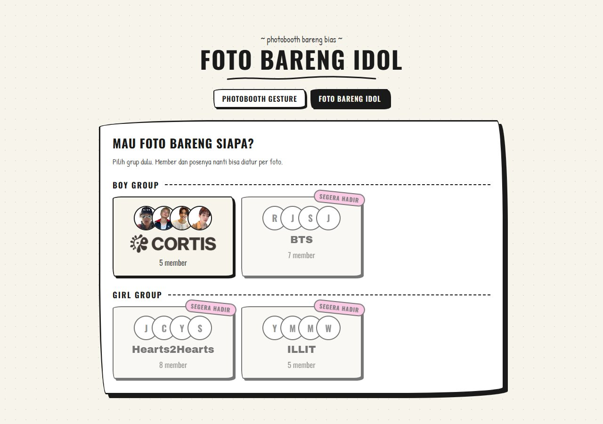
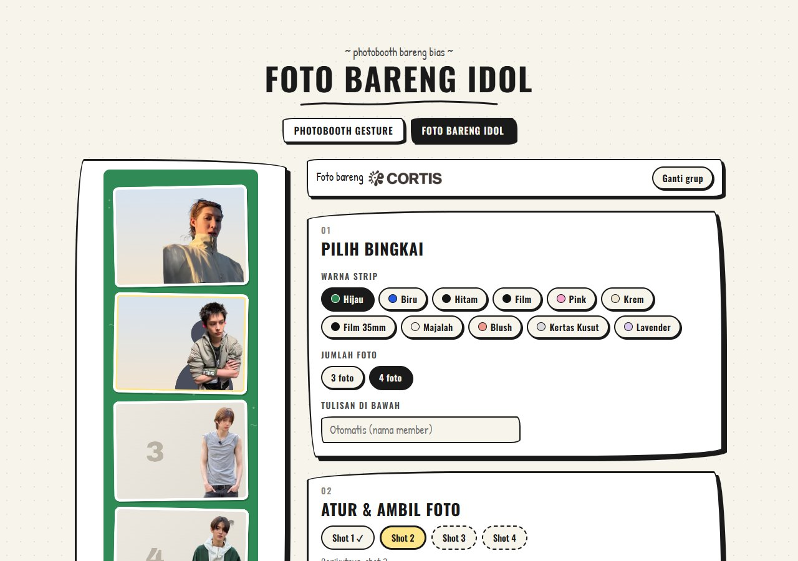
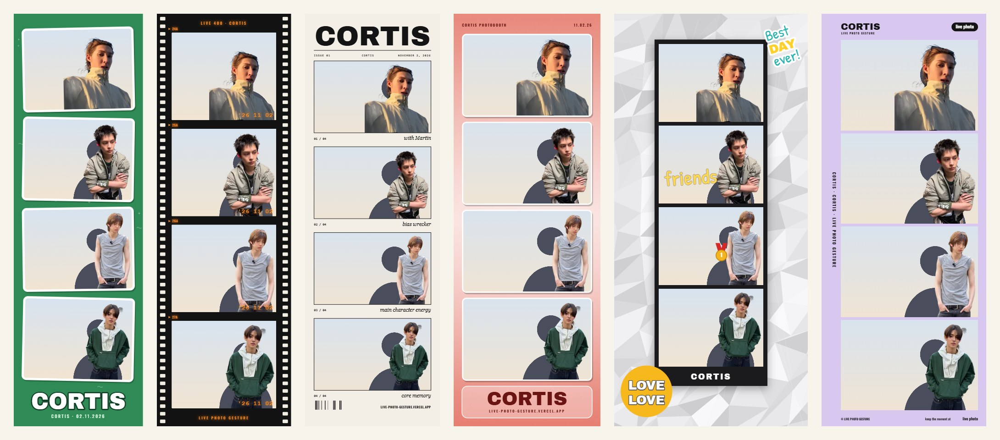

<div align="center">

# 📸 Live Photo Gesture

**Photobooth online yang bisa dikendalikan pakai gerakan tangan, plus mode foto bareng idol K-pop.**

Pose ✋, kepal ✊, hitung mundur 3-2-1, *cekrek!* Pilih bingkai, atur tata letak, lalu download atau share hasilnya.

[](https://live-photo-gesture.vercel.app/)




</div>

---

## ✨ Ada apa saja?

| | Mode | Isinya |
|---|---|---|
| 🖐️ | **Photobooth Gesture** | Kamera membaca gerakan tangan & ekspresi wajah, efek dan suara berubah sesuai pose, foto diambil cukup dengan gesture. |
| 💜 | **Foto Bareng Idol** | Bikin photo strip bareng member idol favorit. Atur member & pose tiap foto, pilih desain strip, langsung download. |

---

## 🖐️ Photobooth Gesture

### Gesture tangan
| Gesture | Efek |
|---------|------|
| ✋ 5 jari | Normal |
| ✌️ 2 jari | Foto jadi blur |
| ☝️ Telunjuk | Mode telunjuk |
| ✊ Kepal | Mode "lawan" 🔥 (layar bergetar) |
| 🤟 Metal | Mode metal |
| 🫰 Sarangheyo | Hujan hati ❤️ |

### Ekspresi wajah
| Ekspresi | Efek |
|----------|------|
| 😲 Mulut terbuka lebar | Mode ngangap |
| 😡 Cemberut | Mode galau |
| 🤭 Tutup mulut pakai tangan | Mode rahasia |

### 📷 Cara ambil foto
Tunjukkan **✋ lalu ubah ke ✊**, hitung mundur 3-2-1 muncul, dan foto masuk ke album. Untuk bingkai dengan banyak foto, hitung mundurnya otomatis berulang sampai semua kotak terisi.

### 🖼️ Bingkai: tema × tata letak
Bingkai dibuat dari dua bagian yang bisa dicampur bebas:

- **6 tata letak**: 1 foto, 2 foto, Strip 3, 2×2, 3×3, Strip Ganda
- **8 tema**: Polos, Polaroid, Sketsa, Film Strip, Vintage (sepia), Sarangheyo, Hitam Putih, Pixel Joy
- **4 template gambar** siap pakai: Strawberry, Cherry Diary, Kamera Film, Kamera Pink

Artinya ada **48 kombinasi** bingkai + 4 template, lengkap dengan pratinjau langsung.



### Fitur lain
- 📒 **Album foto**: Save, Share, Hapus, atau Download Semua
- 🎨 **Warna tombol**: 10 preset, 6 gradient, atau pilih warna sendiri (tersimpan otomatis)
- ☁️ **Upload otomatis ke Supabase** (opsional, kalau `config.js` diisi)

---

## 💜 Foto Bareng Idol

Mode khusus fans K-pop. Pilih grup, lalu foto bareng member-nya dalam satu photo strip.

<div align="center">


</div>

**Langkahnya:**
1. **Pilih grup**: dibagi Boy Group & Girl Group. Saat ini **CORTIS** sudah bisa dipakai (5 member, 44 pose). BTS, Hearts2Hearts, dan ILLIT segera hadir.
2. **Pilih bingkai**: 11 desain strip, 3 atau 4 foto, tulisan bawah bisa diganti.
3. **Atur & ambil foto**:
   - Tiap shot bisa diisi member & pose berbeda, tanpa member, atau foto member upload sendiri
   - Filter **Natural · B&W · Film · Warm · Cool · Soft**
   - Member di **kiri, kanan, atau dua sisi**, plus atur ukuran & posisi
   - **Acak pose**, **mirror kamera**, kamera on/off
   - Ambil per shot (atau tekan `Spasi`), atau **Foto semua otomatis** dengan hitung mundur
4. **Simpan**: download gambar 1200px atau share langsung.

Pratinjau di kiri bergerak *live*: wajahmu langsung muncul di kotak yang aktif, di sebelah member pilihanmu.

### Desain strip
Hijau · Biru · Hitam · Film · Pink · Krem · **Film 35mm** · **Majalah** · **Blush** · **Kertas Kusut** · **Lavender**



---

## 🚀 Jalankan di komputer sendiri

```bash
git clone https://github.com/willsyh/live-photo-gesture.git
cd live-photo-gesture

# jalankan lewat server lokal (pilih salah satu)
npx serve .
# atau
python -m http.server 8000
```

Lalu buka `http://localhost:8000` (atau alamat yang muncul di terminal).

> [!IMPORTANT]
> Buka lewat **server lokal** (atau ekstensi *Live Server* di VS Code), **jangan** klik dua kali `index.html`.
> Kamera butuh `localhost`/HTTPS, dan foto dengan template gambar atau idol tidak bisa disimpan dari `file://`.

### Supabase (opsional)
Tanpa Supabase semua fitur tetap jalan. Supabase hanya dipakai untuk menyimpan salinan foto ke cloud.

1. Buat project di [Supabase](https://supabase.com) dengan bucket publik `photo-assets`
2. Salin `config.example.js` menjadi `config.js`, lalu isi:

```javascript
const CONFIG = {
    SUPABASE_URL: 'https://your-project.supabase.co',
    SUPABASE_ANON_KEY: 'your-anon-key-here',
    AUDIO_BUCKET: 'audio-assets',
    PHOTO_BUCKET: 'photo-assets'
};
```

`config.js` sudah masuk `.gitignore`, jadi kuncinya tidak ikut ter-upload ke GitHub.

---

## 🧩 Menambah konten sendiri

| Mau menambah | Caranya |
|---|---|
| **Tata letak** | Tambah satu baris di `LAYOUTS` (`frames.js`), contoh `{ id: '4x1', name: 'Strip 4', cols: 1, rows: 4, gridWidth: 500 }` |
| **Tema bingkai** | Tambah satu objek di `THEMES` (`frames.js`) |
| **Template gambar** | Taruh gambar di `frames/`, lalu daftarkan posisi kotak fotonya di `TEMPLATES` (`frames.js`) |
| **Grup / member idol** | Tambah di `IDOL_GROUPS` (`idols.js`), lalu taruh PNG transparan di `idols/<grup>/<member>-1.png`, `-2.png`, ... Panduan lengkap di [`idols/README.md`](idols/README.md) |
| **Desain strip idol** | Tambah gaya di `STRIP_STYLES` (`idol-booth.js`); untuk desain dengan susunan sendiri, tambah di `STRIP_KINDS` |

---

## 📁 Struktur project

```
live-photo-gesture/
├── index.html          # Photobooth Gesture
├── script.js           # deteksi gesture, kamera, album, pemilih bingkai
├── frames.js           # tema, tata letak, template & cara menggambar bingkai
├── idol.html           # Foto Bareng Idol
├── idol-booth.js       # logika & desain strip Foto Bareng Idol
├── idols.js            # daftar grup & member idol
├── style.css           # semua tampilan (gaya sketsa)
├── frames/             # gambar template bingkai
├── idols/              # foto member & logo grup (PNG transparan)
├── screenshots/        # gambar untuk README
├── config.example.js   # contoh konfigurasi Supabase
└── config.js           # konfigurasi Supabase kamu (tidak di-commit)
```

---

## 🛠️ Teknologi

- **HTML, CSS, JavaScript murni**: tanpa framework dan tanpa build step
- **[Google MediaPipe](https://developers.google.com/mediapipe)**: Hands (21 titik tangan) & Face Mesh (468 titik wajah)
- **Canvas API**: semua bingkai, strip, dan filter digambar langsung di browser
- **Supabase Storage** (opsional) & **Vercel** untuk hosting

---

## ⚠️ Catatan

Ini adalah **proyek fan-made non-komersial**. Foto member dan logo grup idol adalah milik agensi masing-masing, dan dipakai di sini hanya untuk hiburan. Kalau project ini mau dipakai untuk usaha, ganti dulu semua foto, logo, dan gambar template dengan aset yang memang boleh dipakai.

---

<div align="center">

Dibuat dengan ☕ oleh **Will**
[GitHub @willsyh](https://github.com/willsyh) · [Instagram @willsya_](https://www.instagram.com/willsya_)

Kalau suka, kasih ⭐ ya!

</div>
